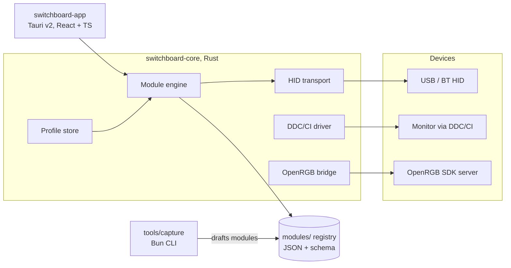

# Switchboard

An open hub for Windows device settings: one app instead of a dozen vendor utilities.

**Status: research phase, as of 2026-11-05.** This repo holds the research, architecture proposal, and
build plan. There is no application yet. "Switchboard" is a working codename.

A typical Windows gaming or workstation PC accumulates a dozen vendor apps. Each has its
own resident service, tray icon, and auto-updater. Together they do four basic jobs:
configure a keyboard, set mouse DPI, dim a monitor, sync some lighting. Most gaming
peripherals store those settings in onboard flash, so the resident service is rarely
needed after setup ([docs/RESEARCH.md](docs/RESEARCH.md), section 1).

The plan is a small native core, a modern UI, and crowdsourced, declarative device
modules. Support for a new device would be a data file the community contributes, not a
C++ plugin. None of this is built yet.

## Proposed architecture

The Rust core is the only resident piece, and only when a feature needs residency (a
hotkey that switches profiles, for example). The footprint target is single-digit megabytes
of RAM and no background CPU; it has not been measured because there is no build. Component notes and data flow are in
[docs/ARCHITECTURE.md](docs/ARCHITECTURE.md).

## The one decision that shapes everything

**We do not rebuild lighting control.** [OpenRGB](https://openrgb.org/) has already
crowdsourced reverse-engineered lighting protocols for 1,000+ devices
([docs/RESEARCH.md](docs/RESEARCH.md), compiled 2026-08-27; third-party figure, approximate), and competing with that is years of duplicated work. Switchboard targets the gap
nobody owns on Windows: device settings (remapping, DPI, polling, profiles, onboard
memory) plus monitor control over DDC/CI. Lighting is proxied to OpenRGB's SDK. See
[docs/DECISIONS.md](docs/DECISIONS.md).

Linux has this in [libratbag/Piper](https://github.com/libratbag/libratbag), a settings
daemon with crowdsourced device definition files. Windows has no open equivalent. That is
the niche.

## What makes it plausibly scale

Crowdsourced device support has always required skilled USB reverse engineering for every
device. Switchboard's bet is an AI-assisted capture workflow: record USB traffic while
using the vendor app, and tooling drafts the device module from the diff between labeled
captures. The contributor's job collapses to following prompts on screen. Details in
[docs/ARCHITECTURE.md](docs/ARCHITECTURE.md).

## Stack

| Layer | Choice | Why |
|---|---|---|
| Desktop shell | Tauri v2 | A hub that replaces bloatware cannot itself be a 300MB Electron resident. Tauri ships a small binary with a webview UI. |
| UI | React + TypeScript + Vite | Planned choice; not yet scaffolded. |
| Core / daemon | Rust (`hidapi`, `windows-rs`, `ddc-hi` are candidates, verified in P0) | Raw HID access and a tiny resident process, with no runtime attached. |
| Device modules | Declarative JSON + JSON Schema | Data, not code. Low contribution bar, no arbitrary code execution from the crowd. |
| Tooling / scripts | Bun + TypeScript | Capture CLI, module validation, registry checks. |
| Lint / format | Oxlint + Oxfmt (TS), clippy + rustfmt (Rust) | Planned. |
| CI | GitHub Actions | Module schema validation on every PR. |

## Repo map

| File | What's in it |
|---|---|
| [docs/RESEARCH.md](docs/RESEARCH.md) | The full landscape: what exists, why it exists, where the gap is |
| [docs/ARCHITECTURE.md](docs/ARCHITECTURE.md) | Components, data flow, the AI-assisted RE workflow |
| [docs/MODULES.md](docs/MODULES.md) | Draft v0 spec for declarative device modules |
| [docs/DECISIONS.md](docs/DECISIONS.md) | ADRs: stack, scope, and license decisions with rationale |
| [PLAN.md](PLAN.md) | Phased build plan with acceptance criteria. P0 is the scaffold. |

## License

MIT, see [LICENSE](LICENSE). Revisit before external module contributions arrive
([ADR-005](docs/DECISIONS.md)).
