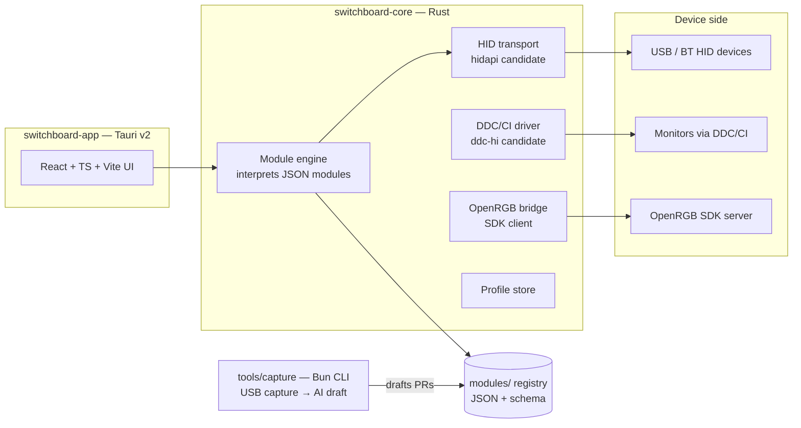

# Architecture (proposal)

Everything here is pre-P0: component boundaries and stack rationale are decided
([DECISIONS.md](DECISIONS.md)), named crates/libraries are **candidates to verify in
P0**, not commitments.

## Components

- **switchboard-core (Rust)** — the only resident piece, and only when the user opts
  into features that need residency (e.g. hotkey-driven profile switching). Owns HID
  transport, the module engine (loads a device's JSON module, renders byte reports from
  templates, applies settings), DDC/CI, the OpenRGB SDK client, and the profile store.
  Footprint target: **single-digit MB RAM, zero background CPU** — the product thesis in
  one number.
- **switchboard-app (Tauri v2, React/TS/Vite)** — the configuration UI. Launched on
  demand; holds no state the core doesn't own. Tauri over Electron is
  [ADR-001](DECISIONS.md).
- **modules/ registry** — one JSON file per device (spec: [MODULES.md](MODULES.md)),
  validated by JSON Schema in CI. Crowdsourced via PRs. Data, not code
  ([ADR-004](DECISIONS.md)).
- **tools/capture (Bun + TS)** — the contributor funnel. See below.
- **Bridges** — lighting is proxied to a local OpenRGB SDK server rather than
  re-implemented ([ADR-003](DECISIONS.md)); LampArray-capable devices are left to
  Windows Dynamic Lighting.

## The AI-assisted module workflow (the novel part)

Every prior project accepted that adding a device requires a skilled human to
reverse-engineer USB traffic. Switchboard's contributor flow makes the capture the
contribution:

1. **Record** — `switchboard capture start` wraps Wireshark/USBPcap, filters to the
   target VID/PID, and prompts a guided script: *"set DPI to 800… now 1600… now toggle
   the second profile."* Each prompt timestamps a labeled window in the capture.
2. **Diff** — the CLI extracts the vendor-report payloads per labeled window and diffs
   across windows, isolating which bytes moved with which setting.
3. **Draft** — an LLM pass over the labeled diffs proposes a module file: report IDs,
   byte offsets, value encodings, checksums, command sequences. The output is a
   *candidate* JSON module, never code.
4. **Verify** — the module engine has a dry-run mode: render the reports the draft
   module would send and compare byte-for-byte against the recorded vendor traffic.
   A draft that reproduces the capture is promoted to "verified against capture."
5. **Submit** — the CLI opens a registry PR containing the module + the (payload-only,
   serial-stripped) capture evidence. CI re-runs schema validation and the replay check.

The contributor's skill requirement collapses to "own the device and follow prompts."
Whether step 3 produces usable drafts for messy protocols (checksums, session
handshakes, encrypted transports) is the project's biggest open risk — P3 in
[PLAN.md](../PLAN.md) exists to answer it early with real captures.

## Stack rationale (short form — full ADRs in DECISIONS.md)

| Decision | Driver |
|---|---|
| Tauri v2, not Electron | An anti-bloatware tool must not be bloatware. Small installer, small resident. |
| Rust core, not Node native modules | The resident piece needs a tiny footprint, service capability, and direct hidapi access without a JS runtime attached. |
| React/TS/Vite UI, Bun tooling, Oxlint/Oxfmt | Matches how the team already builds and tests; no new idioms to learn for the 80% of contribution surface that is UI and tooling. |
| JSON modules, not plugins | Contribution bar, safety (no arbitrary code from the crowd), and machine-verifiability (schema + replay). |

## Non-goals

- **No lighting protocol re-implementation** — OpenRGB bridge only.
- **No kernel drivers** — userspace HID only; devices unreachable from userspace are
  documented as out of scope rather than fought.
- **No cloud dependency** — the registry is a git repo; the app works fully offline.
- **No macOS/Linux in v1** — Linux already has libratbag; Windows is the gap. Keep the
  core portable (hidapi is cross-platform) but don't spend v1 effort there.
